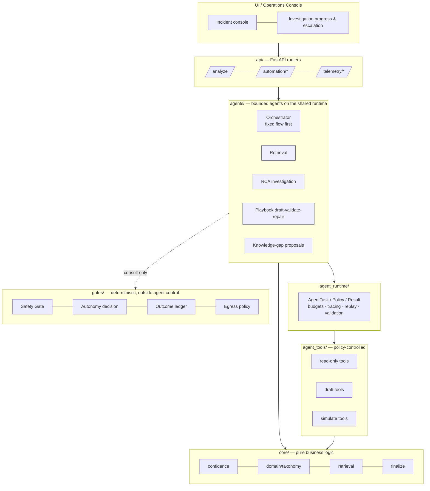
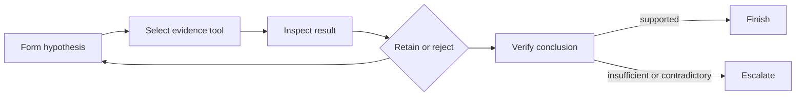

# AI SRE Platform — Agentic Evolution: Detailed Design

| | |
|---|---|
| **Status** | Draft for review |
| **Date** | 2026-10-11 |
| **Branch / baseline** | `agentic-v2` @ `1bc02f2` (identical to `main` at creation) |
| **Scope** | Design only. No behaviour described here is implemented unless marked **[Done]** |

**Legend.** **[Verified]** = confirmed by reading the code at the baseline commit. **[Proposed]** = design decision proposed in this document. **[Open]** = needs a decision from the owner. **[Unverified]** = believed true, not checked. File/line references are as of the baseline commit and will drift.

---

## 1. Purpose and principles

### 1.1 Purpose
Make the platform's modules progressively more autonomous in *investigation and preparation* (plan, use tools, verify, learn) while keeping *operational authority* (what may be executed, with what permission) deterministic and earned from verified outcomes.

### 1.2 Governing principle
> **Capability can expand; execution authority must be earned.**

### 1.3 Design principles
1. **Deterministic stays deterministic.** Safety Gate, Autonomous Gate, Outcome Ledger, RBAC/tenant policy, execution authorization, telemetry threshold rules, audit logging and knowledge-publication approval are ordinary controlled services. Agents consume them; agents cannot modify or bypass them.
2. **Agent only where the next step is uncertain.** Not every module becomes a looping agent.
3. **Verification is first-class.** The SRE equivalent of a coding agent's test suite is: live evidence, dry-run results, validation playbooks, health checks, the outcome ledger, recurrence detection, the backtesting corpus and post-remediation observation windows.
4. **Learning produces proposals, not edits.** Agents never rewrite prompts, thresholds, taxonomy, playbooks or policies directly.
5. **Measure before promoting.** An agent's autonomy level increases only on measured evidence (Section 9), mirroring the "earned autonomy" already used for playbooks.
6. **No framework for its own sake.** A small in-house runtime first; ADK/LangGraph-style frameworks only if a concrete need appears.

### 1.4 Non-goals
- Replacing the current pipeline with a fully dynamic orchestrator.
- Giving any agent direct live-execution access.
- Letting an LLM modify safety or autonomy thresholds.
- Multi-step external LLM calls before the egress policy is enforced (Section 6.3).

---

## 2. Maturity vocabulary (use this in client material)

| Type | Characteristic | Where SLM is today |
|---|---|---|
| Deterministic service | Fixed input-to-output logic | Gates, ledger, telemetry rules, triage |
| AI-assisted service | Fixed workflow containing an LLM call | RCA fallback, playbook generation |
| Bounded agent | Chooses tools and repeats until verified or capped | **Not implemented** |
| Autonomous agent | Pursues a goal over time with governed authority | Future state |

Today the platform is in the first two rows. Avoid "multi-agent" claims until a bounded agent exists and is measured.

---

## 3. Current state (verified)

### 3.1 Architecture as built
- `app.py` (~5.2k lines) is a monolithic FastAPI app containing most routes and business logic. `app/main.py` is a separate stale stub. **[Verified]**
- `agents/` contains specialist "agents" (triage, retrieval, safety, RCA, resolution, learning, playbook) plus `OrchestratorAgent` and an in-process A2A bus (`agents/a2a_protocol.py`). Each agent is a thin wrapper: validate payload → call a function lazily imported from `app.py` → return output plus a `TraceSpan`. **[Verified]**
- Orchestration is a fixed sequence in `OrchestratorAgent.run()` (`agents/orchestrator.py`): triage → retrieval → merge → confidence → safety → RCA → resolution → learning. No branching. **[Verified]**
- The agentic path is behind `AIOPS_AGENTIC_ORCHESTRATOR_ENABLED` (default off; not set in `.env`). Any agentic failure falls back to the legacy pipeline. **[Verified]**
- LLM use is single-shot (Groq fallback in RCA; Groq call in the playbook agent). No tool-calling loop exists. **[Verified for the call sites read; `groq_fallback_real.py` not read in full]**
- Agents import from `app.py` (lazy imports) — the "agents" layer depends on the monolith, not the reverse. **[Verified]**

### 3.2 Defects found and fixed in this effort **[Done]**
Committed on `main` as `1bc02f2` (and therefore on `agentic-v2`).

| # | Defect | Fix |
|---|---|---|
| 1 | RCA agent recomputed confidence with `retrieval_quality=0.0`, capping confidence at 0.35 and forcing the Groq fallback on every agentic request | Confidence computed once in the orchestrator (`_compute_confidence`), passed to RCA as `confidence_context`; RCA no longer recomputes |
| 2 | `fallback_confidence` discarded | Persisted into `confidence_info` |
| 3 | `llm_score` differed from legacy (post-merge certainty vs raw keyword score) | `TriageOutput.llm_score` carries the raw score |
| 4 | RCA domain resolved with `a or b` where `a` could be the truthy string `"general"` | Uses `choose_better_domain` |
| 5 | Agentic path never computed the canonical display domain (e.g. SAP tickets stayed `general`) | Final domain step added to `_analyze_core_agentic` |
| 6 | `_logger` undefined at module scope — the agentic→legacy fallback raised `NameError` | Module-level logger added |

Evidence: 12 unit tests (`tests/test_agentic_confidence_parity.py`); five-ticket legacy-vs-agentic comparison matched on classification, domain, confidence inputs and the confidence passed to the fallback decision (run with Qdrant down, all tickets below the fallback threshold — see Section 9.1).

### 3.3 Open findings (verified, not yet fixed)

**Safety Gate (`agents/automation.py`)**

| Scenario | Current behaviour | Fail-closed? |
|---|---|---|
| Evidence file missing | `pilot_defaults.missing_evidence_status` is `"pass"` in the shipped `safety_gate_config.json` | No |
| Evidence file unreadable | Treated as missing → pass | No |
| Evidence `status` missing/unrecognized | `_status_from_evidence` defaults to pass | No |
| Default snapshot mode (no `CMDB_ENABLED`/`LAB_SNAPSHOT_ENABLED`) | Synthetic dry-mode state returns `pass` with a fresh timestamp | No |
| Stale evidence (> 72 h default) | `warn`; `fail` only in autonomous mode | Partly |
| Snapshot or simulation error | `warn` (advisory) | Warns only |
| Gate evaluation raises | HTTP 400 | Caller-dependent **[Unverified]** |

Further observations:
- `_refresh_live_evidence` writes `drift_status.json`, `rollback_readiness.json` and `error_budget_status.json` on every evaluation. This can overwrite client-supplied evidence of the same name.
- "Rollback readiness" is derived from the blast-radius estimate and asserts "Rollback artifacts available" without checking artifacts. "Error budget" is the dry-run simulation result relabelled.
- With the shipped config all six checks use `adapter_mode: file` (or derived); none pulls from an API.
- The response schema declares `enforcement_mode: "configuration_backed_advisory"`. Whether the execute endpoint hard-blocks on the gate was **not** verified.
- The `fail closed` behaviour that exists (`automation_autonomous_enable_route`, `automation_autonomous_eligible_mapping_route`) concerns the *ledger gate on the autonomy endpoints*, not the Safety Gate evidence path.

**Autonomy gating**
- Two parallel mechanisms: a confidence-summary eligibility check and the ledger tier from `resolution_outcome.autonomous_gate`. Enabling requires both. At execution time only `hold_for_approval` blocks, so `auto_execute_watch` (≥3 outcomes at ≥60% success) is allowed.
- `autonomous_gate` uses only `success_rate` and `total_outcomes`. `recurrence_rate` is computed by `summarize_outcomes` but ignored, so a fix that keeps recurring still earns `auto_execute`.

**Egress**
- A per-tenant flag `allow_client_data_export` exists (`tenant_config/*.json`; `client_a` true, `client_b`/`client_c`/POC false) and is enforced for `export`/`data_export` operations only (`app.py` governance helper, `agents/governance.py`). The Groq fallback and the playbook agent do not consult it.

**Parity gaps (agentic vs legacy `_analyze_core_legacy`)**

| Legacy behaviour | Agentic path |
|---|---|
| Forced fallback when no reusable knowledge and weak local path (`no_reusable_knowledge`) | Missing |
| User-confirmation branch (`user_confirmation_required`) | Safety agent computes it; the response drops it |
| Prefer learned local result after fallback (`should_prefer_learned_local_path`) | Missing |
| Post-RCA guards: symptom/cause lock, container, batch-scheduler, compact-context | Missing |
| Fallback-confidence display rule (`ALLOW_FALLBACK_CONFIDENCE_DISPLAY`) | Different logic |
| Domain-aligned incident filtering | Missing |
| Knowledge-candidate creation (`create_knowledge_candidate`) | Missing — `candidate_record` always `None` |
| Trace persistence (`insert_agent_trace`) | Legacy path only |

**Runtime**
- Traces: an `agent_traces` Postgres table and `insert_agent_trace` exist; only the legacy path writes. **[Verified]** `psycopg2` is not installed in the local venv, so persistence is untested locally.
- No tool registry, no budgets, no cancellation, no record/replay, no cost/token accounting. **[Verified by absence]**

---

## 4. Target architecture



Key relationships:
- Agents call tools only through the runtime; the runtime enforces the policy, budgets and egress checks.
- Agents may *read* gate decisions; no tool exposes gate configuration, thresholds, live execution, prompt publication or knowledge publication.
- `core/` has no FastAPI or agent dependency; both `api/` and `agents/` depend on it. This reverses today's coupling (agents → `app.py`).

### 4.1 Folder structure **[Proposed]**

```
core/            confidence, domain/taxonomy, retrieval, finalize (shared post-RCA logic)
agents/          thin agents + bounded loops; A2A bus
agent_runtime/   AgentTask/Policy/Result schemas, runner, budgets, replay, validation
agent_tools/     tool registry + tool implementations (NOT tools/ — that name is taken by snapshot_engine and backtest scripts)
gates/           safety gate, autonomy decision, outcome ledger, egress policy
api/             FastAPI routers split from app.py; app.py becomes a thin shim so `uvicorn app:app` keeps working
ui/              Streamlit pages (today: page_modules/)
connectors/ adapters/ automation/
evals/           parity runner, golden tickets, backtest harness, agent-trace evals
config/ tenant_config/ docs/ scripts/ infra/ tests/
```
Exclude from the new version: backup/`patch_*` files, the duplicate `infra/` copy of root files, and runtime `data/`.

---

## 5. Agent runtime **[Proposed]**

The loop itself is small; making it trustworthy is the engineering work. The runtime must provide: tool schemas and input validation, tenant and data-export policy, deadlines and step budgets, trace storage, cancellation, retry/idempotency rules, prompt-injection controls, evidence normalization, cost/token accounting, record-and-replay, UI progress events, failure recovery, and model-output validation.

### 5.1 Contracts

```python
class AgentPolicy(BaseModel):
    allowed_tools: list[str]
    risk_level: Literal["low", "medium", "high"]
    max_steps: int
    max_tool_calls: int
    deadline_s: float
    max_tokens: int
    max_cost_usd: float | None
    egress: EgressPolicy            # resolved from tenant policy, see 6.3
    autonomy_level: Literal["L0", "L1", "L2", "L3"]   # see 5.3

class AgentTask(BaseModel):
    task_id: str
    trace_id: str
    agent: str
    goal: str
    tenant_id: str
    incident_context: dict          # ticket text treated as untrusted data
    policy: AgentPolicy
    memory_refs: list[str]          # validated, tenant-scoped memory only
    verification: list[VerifierSpec]  # required checks before "completed"

class ToolCall(BaseModel):
    tool: str; args_hash: str; started_ms: int; latency_ms: int
    status: Literal["ok", "error", "denied", "timeout"]
    result_ref: str                 # pointer into the evidence store, not inline

class AgentRunResult(BaseModel):
    status: Literal["completed", "uncertain", "escalated", "failed"]
    conclusion: dict                # agent-specific, schema-validated
    confidence: float               # produced by the central confidence engine (see 7.4)
    uncertainty: list[str]
    evidence_refs: list[str]
    tool_calls: list[ToolCall]
    verification: VerificationResult
    proposed_memory_updates: list[MemoryProposal]   # proposals only (see 6.5)
    trace: list[TraceSpan]
    cost: CostMeta                  # tokens, model, provider, latency, external_call_count
```

```python
class ToolSpec(BaseModel):
    name: str
    tier: Literal["read", "draft", "simulate"]       # no "execute" tier exists
    input_schema: dict; output_schema: dict
    timeout_s: float
    idempotent: bool
    tenant_scoped: bool
    max_result_bytes: int
    redaction: Literal["none", "basic"]
```

### 5.2 Runner behaviour
1. Validate the task and resolve the egress policy; deny early if the policy forbids required external calls.
2. Loop: planner proposes the next step as **schema-constrained JSON** (choose a tool from `allowed_tools`, or finish/escalate) → runtime validates → executes with timeout → records span → feeds a size-capped, sanitized result back.
3. Stop on: verification satisfied, budget exhausted, deadline, repeated no-progress, policy denial, or cancellation.
4. Always return an `AgentRunResult`; never raise to the caller. A `failed`/`escalated` result routes to the existing deterministic path.
5. Record/replay: persist tool results and model outputs keyed by hash so a run can be replayed deterministically in evals.

### 5.3 Agent autonomy ladder **[Proposed]**
Mirrors the earned-autonomy model used for playbooks. Promotion needs measured evidence (Section 9.3).

| Level | Meaning |
|---|---|
| L0 | Deterministic path only |
| L1 | Deterministic path; loop engages only on uncertainty; read-only tools |
| L2 | Loop by default; read-only tools |
| L3 | May write *drafts/proposals* to candidate registries (never publish) |
| — | There is no agent level for execution. Execution is only ever granted by the deterministic gates. |

---

## 6. Tools, governance and safety

### 6.1 Tool registry — initial read-only set **[Proposed]**

| Tool | Purpose | Backing code | Tier |
|---|---|---|---|
| `incident_kb_search` | Similar incidents/KB | `run_hybrid_retrieval`, `fetch_rag_context` **[Verified]** | read |
| `outcome_lookup` | What worked / recurred | `resolution_outcome.summarize_outcomes`, `get_outcomes` **[Verified]** | read |
| `pattern_lookup` | Dominant causes/actions | `knowledge_manager.get_pattern_intelligence` **[Verified]** | read |
| `cmdb_lookup` | Dependencies/ownership | `adapters/servicenow_cmdb.py` **[Verified present]** | read |
| `change_lookup` | Recent changes | **[Open]** — no dedicated change source identified; candidate is the `change_conflict` evidence/ITSM change tables | read |
| `evidence_lookup` | Evidence/telemetry for a hypothesis | evidence store / telemetry events | read |
| `playbook_validate` | Dry/lab validation | `tools/snapshot_engine.py` (forced dry) and `validate_*.yml` playbooks | simulate |

Agents get **no** access to: live execution, gate/safety configuration, prompt publication, knowledge publication, or autonomy enablement.

### 6.2 Authority matrix

| Capability | Agent | Deterministic service | Human |
|---|---|---|---|
| Retrieve / read | Yes | — | — |
| Hypothesize, cite evidence | Yes | — | — |
| Draft playbook / KB / taxonomy / backtest-case proposals | L3 only, as candidates | — | Approves |
| Publish knowledge, change thresholds/policy | **No** | — | Approves, versioned |
| Evaluate safety, grant autonomy | **No** | Yes | Overrides per policy |
| Execute remediation | **No** | Executor, after gates + approval | Approves (human-in-loop) |

### 6.3 Egress policy **[Proposed]**
**Problem [Verified]:** tenant flag exists but is not applied to Groq fallback or the playbook agent. Multi-step loops multiply the data sent externally.

**Design:** `gates/egress.py` exposes `egress_decision(tenant_id, purpose, data_classes) -> Allow | AllowRedacted | Deny`, called by the runtime before any external model call and by the existing Groq fallback and playbook agent. Every decision is audit-logged.
- Today's flag `allow_client_data_export` means *export*; it may not cover LLM egress. **[Open]** Introduce explicit tenant keys, e.g. `allow_external_llm` (bool), `external_llm_redaction` (`none|basic`), `allowed_llm_providers` (list).
- On `Deny`: use the local model path or escalate; never send.
- Bound the data classes sent (ticket text, retrieved incident snippets, CMDB fields) and cap tool-result size.

### 6.4 Prompt-injection and untrusted-data controls **[Proposed]**
- Ticket text, KB articles, CMDB fields and tool outputs are **data, never instructions**: fenced in the prompt and labelled untrusted.
- Per-run tool allowlist; tool arguments are schema-validated values, never free-form shell or code.
- Model output must validate against the step schema; invalid output counts as a failed step.
- Only read/simulate tools exist in the first release, so a successful injection cannot cause execution.
- Results are size-capped and stripped of anything resembling credentials before being fed back.

### 6.5 Learning and memory governance **[Proposed]**
Agents emit **proposals**, each versioned and rollback-able, with provenance (task_id, trace_id, evidence refs, author=agent):
investigation memory notes, new backtest cases, playbook revision candidates, knowledge/KEDB article candidates, classification corrections, threshold-recalibration recommendations.

Rules: tenant isolation by construction (memory keyed by tenant); validation before persistence; human approval before anything affects retrieval or policy; the existing candidate lifecycle (draft → approve → enable) is reused. Persisting agent memory directly is out of scope until this exists. Agent memory must not be written to the JSON-file stores (race-prone per the June status review); use Postgres.

### 6.6 Safety Gate hardening **[Proposed — P0]**
Goal: *no stale, unavailable, unreadable, unrecognized or synthetic evidence can produce a pass where a pass would permit live or autonomous execution.*

1. **Evidence provenance.** Every evidence record carries `provenance ∈ {client_supplied, live, derived, synthetic, missing}`.
2. **Mode-aware defaults** (replaces the single `missing_evidence_status`):

| Condition | simulation | live (human-approved) | autonomous |
|---|---|---|---|
| Missing / unreadable / unrecognized status | pass | warn (override required) | fail |
| `synthetic` or `derived` evidence | pass | warn | fail |
| Stale beyond TTL | pass | warn | fail |
| Snapshot/simulation error | warn | warn | fail |

3. **Rollback readiness** is either `verified` (artifacts checked against the local rollback store) or `estimated`; `estimated` follows the `derived` row above and its text must say so.
4. **Separate namespaces.** The gate writes its own evidence under a generated namespace (e.g. `data/evidence/_generated/`) with provenance; it never overwrites client-supplied files. Fresh client evidence takes precedence over derived evidence.
5. **Explicit error state.** A gate exception returns `gate_status: "error"`, which every executor treats as blocked.
6. Verify (and test) that the execute endpoint hard-blocks on gate status. **[Open — currently unverified]**

Completion test: a failure-matrix test suite where every row marked non-pass above is non-pass.

### 6.7 Autonomy decision **[Proposed — P0]**
- **Consolidate** the confidence-summary eligibility and the ledger tier into a single `AutonomyDecision` service returning `{tier, allowed, reasons[]}`. Any deny wins.
- **Recurrence-aware tiering.** Recommended: count `recurrence_detected` outcomes as non-success for tiering (`resolved_without_recurrence_rate`), with thresholds in config, not code. Alternative: a separate recurrence cap. **[Open]**
- **`auto_execute_watch`** (≥3 outcomes at ≥60%) currently permits autonomous execution. **[Open]** Decide whether the watch tier requires human confirmation.
- Threshold values stay in versioned config and are changed only by humans.

---

## 7. First bounded agent: RCA investigation loop **[Proposed]**

### 7.1 Placement
Inside the RCA step, behind a new flag (proposed `AIOPS_AGENTIC_RCA_LOOP_ENABLED`, default off). It replaces the one-shot `maybe_run_fallback` call when it engages. The deterministic path remains the default and the fallback.

### 7.2 Engage only when (any)
- Central confidence is below `CONFIDENCE_THRESHOLD` (0.60 in `.env`).
- Retrieval quality is below `MIN_RETRIEVAL_SCORE`.
- Evidence sources conflict.
- No reusable knowledge exists.
- Ticket impact is high and the cause uncertain.

### 7.3 Loop and limits



| Limit | Proposed value |
|---|---|
| Tool calls | 4–6 |
| Wall-clock | 45–60 s |
| Tools | Read-only only |
| Query reformulation | At most one per source |
| Evidence | Each material hypothesis cites ≥1 evidence ref |
| Outcome | Escalate when evidence is insufficient or contradictory |

### 7.4 Output and confidence
Output stays compatible with today's `RCAOutput.analysis` (classification, probable causes, next checks, recommended actions, confidence, escalate) plus `evidence_refs`, tool calls and verification.
**Confidence remains owned by the central confidence engine, not the agent.** Add an optional `evidence_grounding` input to the engine rather than letting the agent self-report. RCA contributes reasoning; the orchestrator/engine owns the number.

### 7.5 Model choice and reliability **[Open]**
Free-form tool use on a small local model is unreliable. Constrain the planner to a structured choice among a few tools. Using the larger external model for planning is allowed only if the egress policy permits (6.3). Pin temperature and record/replay for evals.

### 7.6 Latency
`/analyze` is synchronous today. Loops may take tens of seconds; plan for an asynchronous job with streamed progress events to the UI. **[Open]** (sync-with-timeout vs async job).

---

## 8. Parity and finalization **[Proposed — P0]**

### 8.1 Shared finalization
Extract the post-RCA block of `_analyze_core_legacy` (guards, domain/classification locks, fallback-display rules, domain-aligned incident filtering, candidate creation, trace persistence) into `core/finalize.py`. Both paths call it. This is the large item because the functions involved are 100–550 lines each in a monolith.

Per row of the parity gap table (3.3), record one of: **port**, or **intentional difference (documented)**.

### 8.2 Comparator
Compare structured decisions and quality signals, **not prose**: classification, domain, confidence and its inputs, fallback decision and reason, linked resolution/playbook, candidate creation, confirmation-required, and the *set* of retrieved incident IDs. The five-ticket run so far covers a subset of these.

### 8.3 Golden ticket set and baseline
- Representative incidents across domains, run with **Qdrant up** and with tickets above and below the fallback threshold (the first run exercised neither).
- Versioned baseline: results stored with model, prompts, settings, code version.
- Backtest status per the June review: 23-case baseline (avg 0.7443) and sparse current results; a full re-run is a prerequisite. **[Unverified since June]**

---

## 9. Evaluation and promotion

### 9.1 Evidence so far and its limits
Legacy and agentic matched on five synthetic tickets, but Qdrant was down (retrieval quality 0 on three) and every ticket scored below the fallback threshold. The strong-retrieval/no-fallback case is covered only by unit tests.

### 9.2 RCA pilot metrics
Correct-classification rate · evidence-grounded RCA rate · unsupported-cause rate · human override rate · escalation appropriateness · unnecessary external LLM calls · median and p95 latency · cost per investigated incident · recurrence after recommended remediation.

### 9.3 Promotion criteria **[Proposed — thresholds Open]**
Promote L0→L1→L2 only if the loop improves evidence-grounded rate and does not raise unsupported-cause rate, while staying within an agreed latency budget and with zero egress-policy violations. Numeric thresholds to be set from the baseline.

### 9.4 Observability
Persist agentic traces to `agent_traces` (extend schema for tool calls, model, tokens, cost via migration). Show investigation steps, evidence, uncertainty and escalation state in the UI.

---

## 10. Delivery plan

Sizes are relative (S/M/L), not calendar estimates.

| Phase | Deliverable | Size | Exit criterion |
|---|---|---|---|
| **A0** | Gate hardening (6.6) | S–M | Failure-matrix tests all non-pass |
| **A0** | Egress enforcement on Groq fallback + playbook agent (6.3) | M | Tenant with LLM egress off → zero external calls |
| **A0** | Recurrence-aware, consolidated autonomy decision (6.7) | S | Test: high recurrence lowers tier |
| **A1** | Shared finalization + parity completion (8) | L | Golden tickets match on structured decisions; differences documented |
| **A1** | Versioned baseline (8.3) | M | Stored and reproducible |
| **A2** | Runtime schemas, tool registry (read-only), trace persistence (5, 6.1, 9.4) | M | Contracts reviewed; tools unit-tested; agentic traces persisted |
| **B** | Bounded RCA loop behind flag + record/replay (7) | L | Meets 9.3 vs baseline |
| **C** | Adaptive retrieval | M | Higher relevant-match rate, fewer unnecessary LLM fallbacks |
| **D** | Playbook generate–validate–repair (draft only) | M | More candidates pass dry-run at first human review |
| **E** | Knowledge-gap and pattern proposals | M | Fewer repeated knowledge gaps |
| **F** | Dynamic orchestration (safe parallel reads) | M | Better routing than fixed flow in controlled backtests |
| **G** | Earned autonomous execution | — | Sustained resolution rate, low recurrence, safe rollback; authority from gates only |

Sequencing rationale: A0 items are small, independent and address safety/egress risk before more capability is added; A1 provides the trustworthy baseline; A2 builds the foundation once; B proves one loop; later phases reuse the runtime. A dynamic orchestrator (F) has little value until specialist agents (B–D) are reliable.

---

## 11. Risks and mitigations

| Risk | Mitigation |
|---|---|
| Client data sent externally by multi-step loops | Egress policy enforced and audited before any loop ships (6.3) |
| Prompt injection via ticket/KB/CMDB text | Untrusted-data handling, read-only tools, schema-validated I/O (6.4) |
| Unreliable small-model planning | Constrained schema, bounded steps, deterministic fallback (7.5) |
| Latency of loops in a synchronous API | Async job + progress events (7.6) |
| Non-determinism undermining backtests | Pinned settings, record/replay (5.2) |
| Race conditions in JSON-file stores | Move agent memory and traces to Postgres first (6.5) |
| Refactor of a 5k-line monolith | Strangler approach: extract finalization and core logic incrementally; keep `uvicorn app:app` working via a shim |
| Overstated claims to clients | Use the maturity vocabulary (Section 2) |
| Divergent copies (`SLM`, `SLM_Repo`, `SLM_Agentic`) | Branch/worktree on one history; `SLM` stays the local working copy with secrets and data |

---

## 12. Open decisions

1. **Egress:** which tenants may send ticket text to an external LLM, and does the existing `allow_client_data_export` cover this or do we add explicit keys?
2. **Safety Gate default:** change from "missing evidence passes" (pilot) to the mode-aware table in 6.6? This changes demo behaviour.
3. **Evidence namespace:** approve writing gate-generated evidence separately from client evidence?
4. **Baseline set:** which tickets form the golden set, and can Qdrant (and Postgres) be started for the run?
5. **Autonomy semantics:** recurrence as failure vs separate cap; whether `auto_execute_watch` may execute autonomously.
6. **Loop hosting:** synchronous with timeout vs asynchronous job.
7. **Planner model:** local-constrained vs external, subject to egress policy.
8. **Promotion thresholds:** numeric values after baseline.

---

## 13. Assumptions and unverified items

- The agentic flag is off in all environments unless set outside `.env`/`.env.vastai.example`. **[Unverified outside those files]**
- `groq_fallback_real.py` and `agents/resolution_agent.py` were not read in full; claims about single-shot LLM use cover the call sites reviewed.
- Execute-endpoint enforcement of the gate, behaviour of callers when the gate raises, and UI handling are **[Unverified]**.
- Backtest and "client-supplied evidence" statements originate from `PROJECT_STATUS_JUNE2026.md` and have not been re-verified.
- `/evidence/submit` writing the same files the gate overwrites is per the June status document; the overwrite itself is verified in code.
- Line references drift; they identify the baseline only.

## 14. Appendix — verified evidence index (baseline `1bc02f2`)

| Topic | Location |
|---|---|
| Fixed pipeline | `agents/orchestrator.py` `OrchestratorAgent.run` |
| Central confidence | `agents/orchestrator.py` `_compute_confidence`; `agents/rca_agent.py` |
| Safety Gate refresh | `agents/automation.py` `_refresh_live_evidence`, `_build_pre_execution_safety_gate` |
| Evidence defaults / TTL | `agents/automation.py` `_missing_evidence_detail`, `_status_from_evidence`, `_check_evidence_ttl`; `config/client_onboarding/safety_gate_config.json` |
| Autonomy endpoints | `agents/automation.py` `automation_autonomous_enable_route`, `automation_autonomous_eligible_mapping_route` |
| Ledger gate | `resolution_outcome.py` `autonomous_gate`, `summarize_outcomes` |
| Egress check | `agents/governance.py`; `app.py` governance helper; `tenant_config/*.json` |
| Legacy-only behaviours | `app.py` `_analyze_core_legacy` |
| Agentic response builder | `app.py` `_analyze_core_agentic` |
| Trace storage | `postgres_store.py` `ensure_agent_traces_schema`, `insert_agent_trace` |
| Tests | `tests/test_agentic_confidence_parity.py` (12) |
