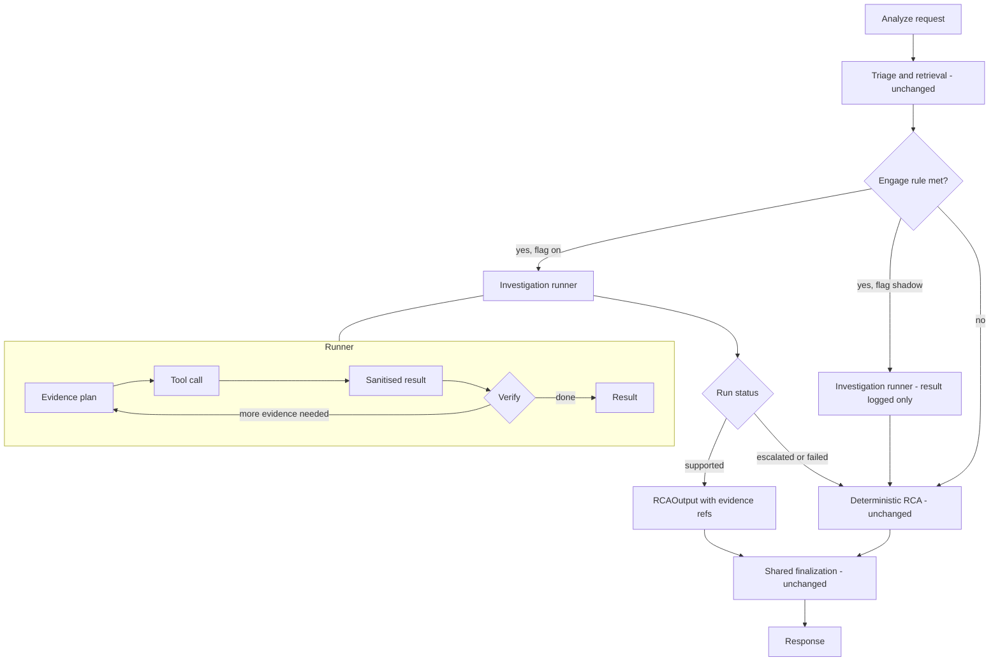

# Release 2 — Bounded Investigation Agent: Detailed Design

**Status:** proposal for owner review. Nothing here is built. Companion to `docs/RELEASE_2_PLAN.md` (scope, phases, decisions) and
`docs/AGENTIC_DESIGN.md` (principles and the long-range roadmap). This document is the engineering design for phases R2-0 to R2-4.

**Tags used:** **[Verified]** checked against the code or the live system; **[Measured]** observed in a test, with its sample size;
**[Proposed]** a design choice; **[Assumed]** a default I picked for a decision you have not answered yet (see section 14).

---

## 1. Goals, non-goals, invariants

**Goal.** When the one-shot analysis is unsure, run a short, bounded, read-only investigation that gathers tenant-scoped evidence,
tests hypotheses against it, and returns either a supported analysis with evidence references or an explicit escalation. Prove it helps
(section 11) before it runs by default.

**Non-goals.** Executing anything. Approving anything. Changing thresholds, policy or tenant settings. Publishing knowledge. Granting
autonomy. Writing to any store except its own run records. Forecasting (TimesFM) and CMDB or change lookups (no data yet).

**Invariants (each is enforced by code and tested, not by prompt):**
1. **No authority.** Tools are read-only; the runtime has no code path to execute, approve, publish or change configuration.
2. **Tenant comes from the server.** Every tool receives the tenant from the request context. The model cannot choose, change or see
   another tenant (section 6.2).
3. **Bounded.** Every run has hard budgets for steps, tool calls, wall-clock time, tokens and result size. A run always ends with a
   result object; it never raises into the caller.
4. **Deterministic fallback.** Any failure, timeout, policy denial or malformed model output returns control to the existing
   deterministic analysis, unchanged.
5. **Confidence is not self-reported.** The central confidence engine owns confidence; the loop supplies evidence, not a score.
6. **Egress is governed.** A model call outside the machine passes the tenant egress policy and is audited, as today.
7. **Off by default.** Flag `AIOPS_AGENTIC_RCA_LOOP` is `off`, `shadow` or `on`; the default is `off`.

---

## 2. Starting point (what exists and is reused)

| Piece | State | Where |
|---|---|---|
| Fixed analysis pipeline | **[Verified]** triage → retrieval → safety → RCA → resolution → learning; legacy and agentic paths share one post-RCA finalization (`finalize_post_rca_state`) | `agents/orchestrator.py`, `app.py` |
| RCA contract | **[Verified]** `RCAInput` (ticket, domain, classification, certainty, incidents, rag_context, primary_confidence, linked knowledge, force_fallback, tenant, knowledge_scope) and `RCAOutput` (final_classification, domain, analysis, fallback fields, confidence_info, response_source, decision, candidate_record, routed_intents) | `agents/models.py` |
| One-shot RCA with optional Groq fallback | **[Verified]** `maybe_run_fallback`: runs when confidence < `CONFIDENCE_THRESHOLD` (0.65) or forced, only if fallback is enabled, configured and the tenant egress policy allows it | `app.py`, `egress_policy.py` |
| Retrieval | **[Verified]** PostgreSQL + pgvector, three layers (tenant, learned, base), recall 0.97–0.99, 0.2–0.6 s warm | `pg_vector_store.py`, `retrieval_engine.py` |
| Tenant history | **[Verified]** `client_ticket_records` (PFG 4,029; PYPL 337) with `ticket_id, opened_at, resolved_at, assignment_group, short_description, raw_json` | PostgreSQL |
| Outcome ledger | **[Verified]** strict per-tenant match; `summarize_outcomes`, `get_outcomes`; no outcomes recorded yet | `resolution_outcome.py` |
| Pattern intelligence | **[Verified]** `get_pattern_intelligence(classification, tenant_id)` | `knowledge_manager.py` |
| In-process agent bus and spans | **[Verified]** `a2a_protocol.TraceSpan` (agent, intent, timings, summaries, decision, status) | `agents/a2a_protocol.py` |
| Trace table | **[Verified]** `agent_traces`: `trace_id, span_id, parent_span_id, agent_name, operation, status, input_summary, output_summary, latency_ms, error, metadata(jsonb)`. **No tenant column, no tool or model fields** | PostgreSQL |
| Local model | **[Verified]** Gemma 3 4B through LM Studio, OpenAI-compatible, supports `response_format: json_schema` | `settings_portable.py` |

---

## 3. Architecture



**Placement.** Inside the RCA step (`agents/rca_agent.py`), after retrieval and before the one-shot fallback. When the loop returns
`supported` it replaces the one-shot fallback call for that request; otherwise the existing path runs exactly as today.

**Modes.** `off`: nothing changes. `shadow`: the loop runs after the deterministic RCA has produced its answer, in a background thread with
the same budgets; its result is stored and scored but never changes the response. `on`: as in the diagram.

---

## 4. Contracts **[Proposed]**

New package `agentruntime/` (not inside `agents/`, to keep the runtime independent of the pipeline agents).

```python
class AgentPolicy(BaseModel):
    tenant_id: str                      # set by the server, never by the model
    allowed_tools: list[str]            # subset of the registry
    max_steps: int = 6
    max_tool_calls: int = 6
    deadline_s: float = 45.0
    max_result_chars: int = 6000        # per tool result, after sanitising
    max_model_tokens: int = 1500        # per planner call
    planner: Literal["rules_then_model", "rules_only", "model"] = "rules_then_model"
    egress: EgressDecision | None       # resolved up front; None means no external model calls
    mode: Literal["shadow", "on"]

class ToolSpec(BaseModel):
    name: str
    description: str                    # what the planner sees
    input_schema: dict                  # JSON schema; validated before the call
    max_results: int
    timeout_s: float = 8.0
    tier: Literal["read"] = "read"      # nothing above read exists in Release 2

class EvidenceRef(BaseModel):
    ref_id: str                         # "e1", "e2", ... stable within a run
    tool: str
    source: str                         # e.g. "incident:inc108", "ticket:INC3706653", "outcome:cpu_saturation"
    snippet: str                        # capped excerpt, shown to the operator
    score: float | None

class Hypothesis(BaseModel):
    cause: str
    status: Literal["supported", "weak", "rejected"]
    evidence: list[str]                 # EvidenceRef.ref_id values; a supported hypothesis needs at least one
    notes: str = ""

class AgentStep(BaseModel):
    n: int
    kind: Literal["plan", "tool", "verify"]
    tool: str | None
    tool_input: dict | None
    result_summary: str                 # capped
    evidence_added: list[str]
    duration_ms: int
    model: str | None
    tokens_in: int = 0
    tokens_out: int = 0
    error: str | None

class AgentRunResult(BaseModel):
    run_id: str
    status: Literal["supported", "escalated", "failed", "denied", "timeout"]
    reason: str                         # stop reason in one line
    hypotheses: list[Hypothesis]
    evidence: list[EvidenceRef]
    steps: list[AgentStep]
    analysis: dict | None               # RCAOutput.analysis-compatible, present only when status == "supported"
    evidence_grounding: float | None    # section 8.2
    duration_ms: int
    mode: str
```

`AgentRunResult.analysis` uses the same keys as today's `RCAOutput.analysis` (classification, probable_causes, next_checks,
recommended_actions, escalate) so downstream finalization and the UI need no change.

---

## 5. Runtime **[Proposed]**

### 5.1 Runner algorithm
1. **Admit.** Validate policy; resolve egress once. If the plan needs an external model and the tenant denies it, the planner mode drops
   to `rules_only` (no failure).
2. **Loop** until a stop condition, at most `max_steps`:
   1. *Plan:* produce the next action (section 7). The action is `tool(name, input)`, `finish`, or `escalate`.
   2. *Validate:* tool name in `allowed_tools`; input matches the tool's JSON schema; budget remaining; the same tool with the same input
      has not already run (duplicate calls are skipped and counted as no progress).
   3. *Execute:* call the tool with the server-held tenant and a timeout; capture exceptions as a failed step, never as a crash.
   4. *Sanitise:* section 6.3. Add `EvidenceRef` entries.
   5. *Verify:* update hypotheses (section 8.1); check the stop conditions.
3. **Stop on:** a supported conclusion; budget exhausted (steps, tool calls, wall clock, tokens); two consecutive steps with no new
   evidence; a policy denial; cancellation; or an unrecoverable error.
4. **Return** an `AgentRunResult`. `supported` requires at least one hypothesis marked supported with evidence; anything else is
   `escalated` (insufficient or contradictory), `timeout`, `denied` or `failed`, and the caller uses the deterministic path.

### 5.2 Execution model
`/analyze` is synchronous today. In `on` mode the runner executes in a worker thread and the request waits up to `deadline_s`; on timeout
the request proceeds with the deterministic result and the run is marked `timeout`. In `shadow` mode the request never waits.
An asynchronous job with streamed progress is deferred to a later release **[Assumed]** (decision 2).

### 5.3 Determinism and replay
Every model call and tool result is stored with a content hash of its input. A **replay** run takes a stored run and re-executes the
runner with the recorded outputs substituted, so the same decisions follow without the model or the database. Sampling is pinned
(temperature 0, fixed seed where the server supports it). Replay is the basis for evaluation (section 11) and for regression tests.

### 5.4 Failure behaviour (all return control to the deterministic path)
| Failure | Result |
|---|---|
| Model unreachable or slow | planner falls back to `rules_only` for the rest of the run; if rules also have nothing to do, `escalated` |
| Malformed or off-schema model output | one retry with the validation error shown; then `rules_only`; then `failed` |
| Tool timeout or exception | step recorded as failed; the run continues with other evidence; two consecutive failures stop it |
| Policy denial (egress) | `denied`, planner continues rules-only if possible |
| Deadline | `timeout` |

---

## 6. Tools **[Proposed]**

### 6.1 Release 2 tool set (all read-only)

| Tool | Input | Backing code | Returns | Cap |
|---|---|---|---|---|
| `incident_kb_search` | `query: str`, `scope?: "tenant"\|"all"` | `retrieval_engine.retrieve_incidents` (pgvector, tenant layers) | top incidents: id, title, classification, score, snippet | 5 |
| `ticket_history_lookup` | `host?: str`, `service?: str`, `text?: str`, `days?: int` (default 180, max 400) | `client_ticket_records` filtered by tenant; match on host or text in `short_description` / `raw_json` | recent similar tickets: id, opened/resolved times, group, summary, closure notes | 8 |
| `outcome_lookup` | `classification: str` | `resolution_outcome.summarize_outcomes` | counts, success rate, recurrence rate, last resolved | 1 summary |
| `pattern_lookup` | `classification: str` | `knowledge_manager.get_pattern_intelligence` | dominant causes and actions | 1 summary |
| `evidence_lookup` | `check?: str` | the Safety Gate evidence store, read-only, tenant file only | the evidence items for the tenant and their freshness | 6 |

Not in Release 2: `cmdb_lookup`, `change_lookup` (no source data from PYPL yet), `playbook_validate`, anything that writes.

### 6.2 Tenant isolation rule
The registry's `call(name, input, ctx)` injects `ctx.tenant_id` into the tool; tool input schemas **do not contain a tenant field**, and any
extra field (`additionalProperties: false`) is rejected. Tools query with the tenant as a bound parameter. Each tool has a test that
seeds two tenants and asserts the other tenant's rows never appear, including through the model-supplied `query` text.
`ticket_history_lookup` and `outcome_lookup` are strict-tenant; `incident_kb_search` returns the tenant layers plus the shared base,
exactly as retrieval does today.

### 6.3 Result sanitising (prompt-injection and size control)
Ticket, KB and note text is **untrusted data**. Before a result reaches the planner or the operator it is: truncated to `max_result_chars`;
stripped of control characters; reduced to the fields in the tool's output schema (no free-form passthrough); and presented to the model
only inside a clearly delimited data block that the system prompt marks as data, never instructions. Tools return structured records,
and the runtime never executes or follows anything found in them. Instruction-like text in a result is flagged in the step record.

---

## 7. Planner **[Proposed]**

### 7.1 Why a hybrid planner **[Measured, small sample]**
A first test of Gemma 3 4B through LM Studio, with the tool choice forced into a JSON schema: **3 of 3 replies were valid structured
output** (so schema constraint works), but **it chose `pattern_lookup` for all three tickets**, including a host-specific ticket where
`ticket_history_lookup` is the obvious first move. Latency was 5–10 s per call warm (44 s on the first call, which loaded the model).
With six steps that alone approaches the 45–60 s budget. Sample size is three, so this is a warning, not a result. It is why the design
does not rely on the small model to choose tools.

### 7.2 Rules first, model second
`planner = rules_then_model` (default):
1. **Evidence plan (deterministic).** From features of the ticket and the current evidence, a rule table proposes the next tool:

   | Condition | Next tool |
   |---|---|
   | ticket text names a host, instance or service id | `ticket_history_lookup(host=...)` |
   | no incident search yet | `incident_kb_search(query=ticket text)` |
   | classification known, no outcome yet | `outcome_lookup`, then `pattern_lookup` |
   | retrieval top score below `MIN_RETRIEVAL_SCORE` and no reformulation used | `incident_kb_search` with a reformulated query (one only) |
   | evidence and hypotheses conflict | `evidence_lookup` |
2. **Model step (only when the rules have nothing to propose or the verification step needs a judgement).** The model is given the ticket,
   the current evidence summary and the remaining tools, and must answer in this schema:

```json
{"action": "incident_kb_search | ticket_history_lookup | outcome_lookup | pattern_lookup | evidence_lookup | finish | escalate",
 "reason": "<one sentence>", "input": { }}
```
   Temperature 0, `max_tokens` capped, strict schema (`additionalProperties: false`). An invalid reply is retried once with the error.
3. **Verification and synthesis** use the model to write the hypotheses and the final analysis from the evidence, in a second schema
   (`hypotheses[]` with `cause`, `status`, `evidence[]`). Hypotheses that cite no evidence are discarded by the runtime, regardless of
   what the model says.

`rules_only` skips the model entirely (used when the model is unavailable or denied) and produces evidence plus a deterministic
summary, which can still be useful to the operator even without a synthesised cause. `model` (the model chooses every step) exists for
evaluation only and is never the default.

### 7.3 Model abstraction
One `PlannerModel` interface with a local implementation (LM Studio, JSON-schema responses) and an external implementation (Groq) that
exists only behind the egress policy. As of 2026-10-14 only PYPL may use the external model, with basic redaction and an audit row per
call **[Verified]**. A larger external planner is a configuration choice, evaluated like any other model (decision 1).

---

## 8. Verification, output and confidence

### 8.1 Hypothesis handling
After each tool result the runtime asks the verify step to update the hypothesis list. Rules enforced in code, not by the model:
a hypothesis is `supported` only if it cites at least one `EvidenceRef` that the runtime recorded; citing an unknown ref makes it
`weak`; a hypothesis contradicted by a later evidence item (the verify step flags it, and the runtime requires a cited counter-ref) is
`rejected`. The run is `supported` when there is a supported hypothesis and no unresolved contradiction among the top two; otherwise
`escalated`.

### 8.2 Evidence grounding and confidence **[Proposed]**
The central confidence engine gains an **optional** input `evidence_grounding` in [0, 1]:
`grounding = supported evidence weight / (supported + contradicting + missing weight)`, where weights come from the evidence scores and
freshness (a ticket from the same host in the last 30 days outweighs a generic base incident). With no loop result the input is absent and
today's formula is unchanged. The loop never writes confidence. Weights are tuned on the evaluation set, not guessed (open item).

### 8.3 Output
`AgentRunResult.analysis` feeds the existing finalization. The response gains an additive `investigation` object (run id, status,
reason, steps, evidence refs, hypotheses, duration) used by the UI and by evaluation; existing consumers ignore it.

---

## 9. Data model and migrations **[Proposed]**

Extend rather than replace the trace table, so existing writers keep working:

```sql
ALTER TABLE agent_traces ADD COLUMN IF NOT EXISTS tenant_id TEXT;
ALTER TABLE agent_traces ADD COLUMN IF NOT EXISTS run_id TEXT;

CREATE TABLE IF NOT EXISTS agent_runs (
    run_id        TEXT PRIMARY KEY,
    request_id    TEXT,
    tenant_id     TEXT NOT NULL,
    mode          TEXT NOT NULL,            -- shadow | on
    status        TEXT NOT NULL,
    reason        TEXT,
    ticket_hash   TEXT,                     -- not the ticket text
    flags_json    JSONB,                    -- budgets and planner mode used
    result_json   JSONB,                    -- AgentRunResult
    duration_ms   INTEGER,
    created_at    TIMESTAMPTZ DEFAULT now()
);
CREATE TABLE IF NOT EXISTS agent_run_events (   -- model calls and tool results, for replay
    run_id        TEXT NOT NULL REFERENCES agent_runs(run_id) ON DELETE CASCADE,
    step          INTEGER NOT NULL,
    kind          TEXT NOT NULL,            -- model | tool
    input_hash    TEXT NOT NULL,
    output_json   JSONB,
    model         TEXT, tokens_in INTEGER, tokens_out INTEGER, latency_ms INTEGER,
    PRIMARY KEY (run_id, step, kind)
);
CREATE INDEX IF NOT EXISTS idx_agent_runs_tenant ON agent_runs (tenant_id, created_at DESC);
```

Retention: runs are kept 90 days **[Assumed]**; `ticket_hash` rather than text limits what the run table holds, but `result_json` contains
snippets of tenant data, so access follows the same tenant rules as the source tables. Migrations are idempotent and run at start-up the
same way the vector schema does.

---

## 10. Integration and UI

| Area | Change |
|---|---|
| `agents/rca_agent.py` | calls the runner when the engage rule is met and the flag is `on` or `shadow`; unchanged otherwise |
| `app.py` | response gains `investigation`; shadow runs are started after the response data is ready |
| Configuration | `AIOPS_AGENTIC_RCA_LOOP=off\|shadow\|on`; budgets in `config/agent_runtime.json` (versioned, human-edited, never agent-writable) |
| Engage rule | confidence below `CONFIDENCE_THRESHOLD`, retrieval below `MIN_RETRIEVAL_SCORE`, no reusable knowledge, conflicting evidence, or high impact with uncertain cause (the five conditions of the design doc) |
| UI (R2-4) | an "Investigation" panel in the Incident Console: steps in order with tool and duration, evidence list with snippets, hypotheses with status, and why it concluded or escalated. Shown only when a run exists |
| Backtesting page | reads `agent_runs` to show shadow runs beside the deterministic result |

---

## 11. Evaluation and promotion **[Proposed]**

**Evaluation set.** (a) The Release 1 golden tickets; (b) a held-out slice of PYPL tickets, chosen so closure notes or findings state the
real cause or fix (for example host-not-available and CMS response-time tickets), removed from the retrievable index for the evaluation
run so the loop cannot simply find the ticket itself; (c) PFG tickets likewise. The owner confirms the ground-truth label for each ticket
in the slice (decision 4). Target size 60–100 tickets.

**Metrics.** Correct-classification rate; evidence-grounded RCA rate (supported hypotheses with valid evidence refs); unsupported-cause
rate (stated causes with no support); escalation appropriateness (escalates when ground truth is not recoverable from the evidence);
unnecessary external calls; median and p95 latency; tool calls per run; failure and timeout rate.

**Procedure.** Shadow mode on the set → compare with the deterministic baseline per metric → replay to check determinism → promotion
review. Promote `off → on-uncertain` only if the evidence-grounded rate improves, the unsupported-cause rate does not rise, p95 stays inside
the budget and there are zero egress violations. Numeric thresholds are set after the first shadow results, then frozen in the plan.

---

## 12. Test strategy

| Layer | Tests |
|---|---|
| Contracts | schema validation, round trips, unknown fields rejected |
| Runner | budgets (steps, calls, time, size), duplicate-call skip, no-progress stop, every failure row of 5.4, never raises |
| Tools | tenant isolation per tool with two seeded tenants; result caps; schema rejection of a tenant field; injection strings stay data |
| Planner | rule table cases; model reply parsing and one retry; off-schema reply handling; `rules_only` complete run |
| Verification | hypothesis without evidence discarded; unknown ref demotes; contradiction handling |
| Replay | a recorded run replays to an identical result without the model or the database |
| Integration | flag `off` leaves responses byte-identical to today; `shadow` never changes the response; `on` falls back cleanly on every failure |
| Safety | assert the registry has no tool above `read`; assert no import of execution or configuration modules from `agentruntime/` |

---

## 13. Delivery plan

| Phase | Work | Exit criterion |
|---|---|---|
| **R2-0** | `agentruntime/` contracts, registry, runner, budgets, sanitising, replay store, migrations | contract and runner tests pass; a stub run persists and replays |
| **R2-1** | the five tools with tenant-isolation tests | each tool passes its isolation and cap tests |
| **R2-2** | rule planner, model planner, verification, `shadow` mode wired into the RCA step | shadow runs complete on the golden set inside the budget; zero policy violations; flag `off` unchanged |
| **R2-3** | evaluation harness, labelled slice, metrics, first shadow report | report vs baseline reviewed; thresholds proposed |
| **R2-4** | `investigation` in the response and the UI panel; `on` for a pilot tenant if R2-3 passes | operator sees why the loop concluded or escalated |

**Before R2-0 starts:** extend the planner experiment from 3 to about 50 tickets (golden set plus PYPL) and record tool-choice accuracy,
schema validity and latency for `rules_then_model` versus `model`; this confirms or changes section 7.

---

## 14. Decisions (and the default I assumed)

| # | Decision | Assumed default |
|---|---|---|
| 1 | Planner model | rules first, local Gemma constrained for judgement; external only where the tenant allows (PYPL today) |
| 2 | Hosting | synchronous with a 45 s timeout; async later |
| 3 | Shadow first | yes; no operator-visible change until R2-3 passes |
| 4 | Ground truth | PYPL and PFG tickets with stated causes in closure notes; owner confirms labels |
| 5 | CMDB and change tools | left out until PYPL sends the data |
| 6 | Forecasting | out of scope; revisit after shadow results |
| 7 | Merge timing | `agentic-v2` merges to `main` after R2-2 passes, not before |
| 8 | Run retention | 90 days |

## 15. Risks and unverified items

- **Small-model reliability** is the main risk; section 7.1 is based on three tickets. The rules-first design limits the exposure; the
  50-ticket experiment decides how much the model is used.
- **Latency.** Warm calls take 5–10 s on this machine; a run with several model calls can approach the budget. Rules-only runs need no model.
- **Evaluation leakage.** A PYPL ticket is already in the index; the evaluation must hide held-out tickets from retrieval or the result is
  meaningless (section 11).
- **Weights for `evidence_grounding`** are unspecified until there is data.
- **Tool coverage.** Without CMDB and change data the loop cannot answer "what changed" questions; escalation will be common for those.
- Not verified: behaviour of other local models, Groq planner quality, real operator reaction to the investigation panel.
